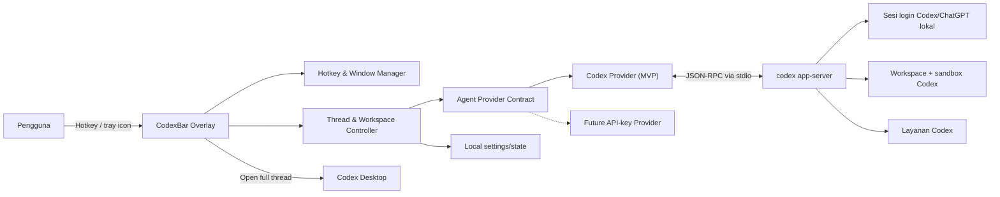
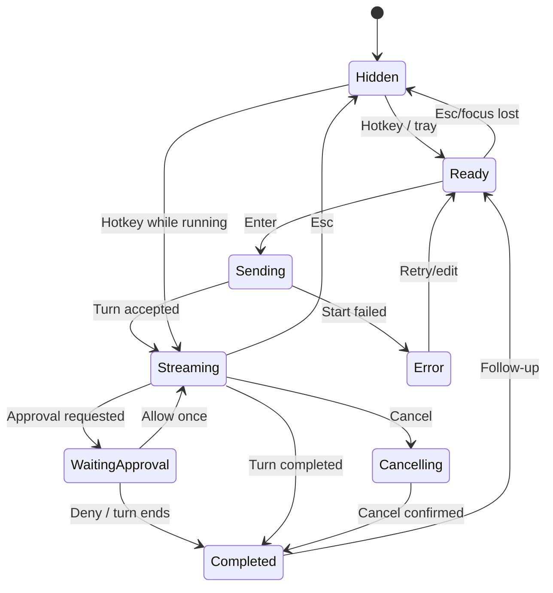

# DPPL — CodexBar

**Dokumen Perancangan Perangkat Lunak**  
**Versi:** 0.5 (Draft)  
**Tanggal:** 29 Juni 2026  
**Platform awal:** Windows 11 x64  

## 1. Ringkasan

CodexBar adalah aplikasi desktop Windows berukuran kecil yang menyediakan input bar floating untuk mengirim prompt ke Codex tanpa membuka jendela Codex secara penuh. Input, output, dan menu/riwayat dipisahkan menjadi floating window tersendiri agar bar utama tetap ringkas. Pengguna memunculkan input melalui hotkey global atau tray icon, mengetik prompt, lalu menerima respons secara streaming pada output window.

CodexBar tidak menggunakan Windhawk, tidak menyuntikkan kode ke `explorer.exe`, dan tidak membutuhkan OpenAI Platform API key. Aplikasi berkomunikasi dengan proses Codex lokal melalui Codex App Server dan menggunakan sesi login ChatGPT/Codex yang sudah ada pada komputer pengguna.

## 2. Tujuan

1. Mengurangi friksi saat mengirim instruksi singkat ke Codex.
2. Memungkinkan akses dari aplikasi apa pun tanpa berpindah jendela.
3. Mempertahankan thread, workspace, sandbox, dan mekanisme approval Codex.
4. Menyediakan pengalaman visual yang terasa menyatu dengan taskbar tanpa memodifikasi taskbar Windows.
5. Menjaga stabilitas Explorer dan menyediakan jalur pemulihan ketika Codex atau jaringan bermasalah.

## 3. Ruang Lingkup

### 3.1 Dalam lingkup MVP

- Overlay textbox borderless dan always-on-top.
- Hotkey global yang dapat diubah; nilai awal `Win+Shift+C`.
- Tray icon sebagai jalur akses dan pengaturan cadangan.
- Pemilihan workspace lokal.
- Membuat thread baru atau melanjutkan thread terakhir pada workspace terpilih.
- Pengiriman prompt melalui Codex App Server lokal.
- Kontrak provider internal dengan implementasi Codex sebagai satu-satunya provider MVP.
- Streaming status dan jawaban Codex.
- Area jawaban yang dapat di-scroll dengan auto-follow yang tidak mengganggu pembacaan.
- Pengaturan lebar, tinggi maksimum, opacity, ukuran font, dan theme overlay.
- Mode pin/unpin untuk memilih antara overlay persisten dan auto-hide.
- Toggle always-on-top yang terpisah dari pin/auto-hide.
- Syntax highlighting dan font monospace otomatis untuk blok kode.
- Quick zoom, word wrap kode, serta reset ukuran dan posisi jendela.
- Tombol salin untuk jawaban dan code block.
- Pembatalan pekerjaan aktif.
- Penanganan permintaan approval secara eksplisit.
- Tombol untuk membuka thread aktif pada aplikasi Codex penuh.
- Dukungan multi-monitor dan DPI scaling.
- Opsi berjalan otomatis saat pengguna masuk ke Windows.
- Penyimpanan konfigurasi lokal tanpa menyimpan kredensial OpenAI.

### 3.2 Di luar lingkup MVP

- Menanam textbox sebagai elemen asli taskbar.
- Windhawk atau injeksi ke proses Windows/Codex.
- Pengganti penuh antarmuka Codex Desktop.
- UI, input, atau penyimpanan API key.
- Provider selain Codex; boundary arsitekturnya disiapkan tetapi implementasinya ditunda.
- Dukungan macOS dan Linux.
- Voice input, screenshot, drag-and-drop, dan lampiran file.
- Sinkronisasi pengaturan lintas perangkat.
- Marketplace atau sistem plugin tersendiri.

## 4. Istilah

| Istilah | Arti |
|---|---|
| Overlay | Jendela kecil tanpa frame yang muncul di atas taskbar. |
| Companion | Proses CodexBar yang berjalan terpisah dari Codex Desktop. |
| Codex App Server | Antarmuka lokal Codex untuk autentikasi, thread, approval, dan event streaming. |
| Workspace | Folder lokal yang menjadi konteks kerja Codex. |
| Thread | Percakapan/sesi kerja Codex yang dapat dilanjutkan. |
| Approval | Persetujuan pengguna sebelum Codex melakukan tindakan tertentu. |

## 5. Keputusan Arsitektur

### 5.1 Pendekatan yang dipilih

CodexBar dibuat sebagai aplikasi WPF pada .NET dengan satu proses UI dan satu proses anak `codex app-server`. Komunikasi dengan App Server menggunakan JSON-RPC melalui standard input/output lokal.

Alasan pemilihan:

- WPF mendukung jendela borderless, always-on-top, styling, dan DPI-aware tanpa runtime browser yang berat.
- `RegisterHotKey` menyediakan hotkey system-wide tanpa keyboard hook global.
- Transport `stdio` tidak membuka port jaringan lokal.
- Codex App Server dirancang untuk rich client yang membutuhkan autentikasi, riwayat percakapan, approval, dan streamed events.
- Isolasi proses memastikan kegagalan overlay tidak menjatuhkan Explorer atau aplikasi Codex resmi.

### 5.2 Pendekatan yang tidak dipilih

| Pendekatan | Alasan ditolak |
|---|---|
| Windhawk/taskbar injection | Rentan terhadap perubahan internal taskbar dan dapat memengaruhi stabilitas Explorer. |
| Modifikasi binary Codex | Tidak didukung, sulit dipelihara, dan akan rusak saat aplikasi diperbarui. |
| OpenAI Responses API langsung | Membutuhkan API key dan billing API terpisah dari paket Codex pengguna. |
| Electron | Mempermudah UI web, tetapi penggunaan memori dan waktu startup tidak sesuai target aplikasi kecil. |
| Deep link saja | Dapat mengisi composer, tetapi tetap membuka jendela Codex penuh dan tidak menyediakan respons di overlay. |

## 6. Arsitektur Sistem



### 6.1 Komponen

#### A. Overlay UI

- Menampilkan textbox, workspace aktif, status thread, respons, error, dan approval.
- Mode ringkas: satu baris input.
- Mode berkembang: respons/approval dengan tinggi maksimum tertentu.
- Merender Markdown, blok kode monospace, dan syntax highlighting secara incremental.
- Menyediakan scroll, copy, quick zoom, word wrap, dan status auto-follow.
- Tidak tampil di taskbar dan tidak mengambil area kerja Windows secara permanen.

#### B. Hotkey & Window Manager

- Mendaftarkan hotkey system-wide melalui `RegisterHotKey`.
- Menghitung monitor aktif dan work area.
- Menempatkan overlay beberapa piksel di atas taskbar.
- Menangani DPI, taskbar auto-hide, perubahan resolusi, dan perpindahan monitor.
- Menutup fokus dengan aman ketika pengguna menekan `Esc` atau mengklik di luar overlay.

#### C. Thread & Workspace Controller

- Menentukan workspace aktif.
- Membuat, melanjutkan, dan mengganti thread.
- Menjaga state machine satu pekerjaan aktif per overlay.
- Mengarahkan approval dan cancel ke Codex Adapter.

#### D. Agent Provider Contract & Codex Provider

- Mendefinisikan operasi minimum: health check, membuat/melanjutkan thread, mengirim prompt, streaming event, cancel, dan approval.
- Mengekspos capability flags sehingga fitur khusus provider tidak dipaksakan menjadi lowest common denominator.
- Implementasi MVP hanya `CodexProvider`, yang menjalankan dan memonitor `codex app-server` sebagai child process.
- `CodexProvider` melakukan handshake, negosiasi versi, dan mapping JSON-RPC ke event internal yang stabil.
- Core dan UI tidak mengetahui detail App Server atau bentuk autentikasi provider.
- Tidak ada credential abstraction yang aktif pada MVP karena Codex memakai sesi login lokal.

#### E. Settings & State Store

- Menyimpan pengaturan non-rahasia.
- Menyimpan workspace terakhir dan thread ID terakhir per workspace.
- Tidak menyalin atau membaca kredensial Codex secara langsung.

#### F. Diagnostics

- Log rotasi lokal dengan level `Error`, `Info`, dan `Debug`.
- Isi prompt dan respons tidak dicatat secara default.
- Menyediakan informasi versi CodexBar, Codex CLI, Windows, dan protokol untuk troubleshooting.

## 7. Rancangan Antarmuka

### 7.1 Tampilan ringkas

```text
┌──────────────────────────────────────────────────────────────┐
│ Codex  C:\project\app   Ask Codex…                    [↗] │
└──────────────────────────────────────────────────────────────┘
```

- Lebar awal: 640 px, dibatasi terhadap work area monitor.
- Tinggi awal: sekitar 64 px.
- Posisi: center-horizontal, 12 px di atas work area bawah.
- Ukuran dapat diubah melalui drag-resize atau halaman Settings.
- Batas lebar: 360 px sampai nilai terkecil antara 1.200 px dan 90% work area.
- Tinggi maksimum respons: 180 px sampai nilai terkecil antara 900 px dan 80% work area.
- Tema awal mengikuti Windows; pilihan MVP adalah `System`, `Light`, dan `Dark`.
- Opacity dapat diatur antara 40%–100%. Saat textbox memperoleh fokus atau approval tampil, opacity efektif minimum adalah 85% agar input dan keputusan tetap terbaca.
- Ukuran font dapat diatur antara 10–24 px dan berlaku pada input serta jawaban.
- Nilai tampilan diperbarui melalui live preview dan disimpan otomatis.

### 7.2 Tampilan respons

```text
┌──────────────────────────────────────────────────────────────┐
│ C:\project\app                         Running…       [■] │
├──────────────────────────────────────────────────────────────┤
│ Memeriksa konfigurasi proyek…                                │
│                                                              │
│ Respons Codex muncul secara streaming di area ini.           │
├──────────────────────────────────────────────────────────────┤
│ Follow-up…                                             [↑]   │
└──────────────────────────────────────────────────────────────┘
```

### 7.3 Interaksi keyboard

| Input | Aksi |
|---|---|
| `Win+Shift+C` | Tampilkan/sembunyikan overlay. |
| `Enter` | Kirim prompt. |
| `Shift+Enter` | Baris baru. |
| `Esc` | Sembunyikan overlay; tidak otomatis membatalkan pekerjaan. |
| `Ctrl+N` | Buat thread baru pada workspace aktif. |
| `Ctrl+O` | Buka thread aktif di Codex Desktop. |
| `Ctrl+.` | Batalkan pekerjaan aktif. |
| `Ctrl++` / `Ctrl+-` | Perbesar/perkecil font respons dan blok kode. |
| `Ctrl+0` | Kembalikan zoom ke ukuran font yang tersimpan. |
| `Ctrl+Shift+T` | Toggle always-on-top. |
| `Ctrl+Shift+W` | Toggle word wrap pada blok kode. |

Hotkey global harus dapat diubah karena kombinasi tertentu dapat sudah digunakan aplikasi lain.

### 7.4 Approval

Ketika Codex meminta approval, overlay berkembang dan menampilkan:

- Ringkasan tindakan.
- Target file/perintah jika tersedia.
- Tombol `Izinkan sekali`, `Tolak`, dan `Buka di Codex`.
- Tidak ada pilihan persetujuan permanen pada MVP.

CodexBar tidak boleh menyetujui tindakan secara otomatis atau mengubah kebijakan sandbox yang aktif.

### 7.5 Scrolling jawaban

- Jawaban panjang berada di dalam area scroll terpisah dari textbox follow-up.
- Mouse wheel, touchpad, scrollbar, `Page Up`, `Page Down`, `Ctrl+Home`, dan `Ctrl+End` didukung.
- Selama posisi pengguna berada di bagian bawah, tampilan mengikuti token baru secara otomatis.
- Ketika pengguna scroll ke atas, auto-follow berhenti agar posisi baca tidak meloncat.
- Tombol `↓ Jawaban terbaru` muncul ketika ada konten baru di bawah viewport.
- Auto-follow aktif kembali saat pengguna menekan tombol tersebut atau kembali ke bagian bawah.
- Posisi scroll dipertahankan ketika overlay disembunyikan dan dibuka kembali pada thread yang sama.
- Rendering jawaban dilakukan per blok agar respons panjang tidak membekukan UI.

### 7.6 Pengaturan tampilan

Pengaturan dibuka dari tray icon atau tombol Settings pada overlay dan mencakup:

| Pengaturan | Nilai MVP |
|---|---|
| Lebar overlay | 360–1.200 px, dibatasi work area |
| Tinggi maksimum | 180–900 px, dibatasi work area |
| Opacity aktif | 40%–100% |
| Opacity idle | 25%–100%, tidak berlaku saat approval |
| Font input | 10–24 px |
| Font respons | 10–24 px |
| Theme | System, Light, Dark |
| Posisi | Bawah tengah, bawah kiri, bawah kanan, atau posisi manual |
| Pin overlay | Aktif/nonaktif |
| Always on top | Aktif/nonaktif; default aktif |
| Auto-hide | Saat kehilangan fokus atau manual saja |
| Word wrap kode | Aktif/nonaktif; default aktif |

Ukuran dan posisi disimpan per monitor agar perpindahan antara layar laptop dan monitor eksternal tidak menghasilkan overlay di luar layar.

`Pin`, `Always on top`, dan `Auto-hide` adalah pengaturan berbeda:

- `Pin` menentukan apakah overlay tetap terlihat setelah kehilangan fokus.
- `Always on top` menentukan apakah overlay berada di atas jendela aplikasi lain.
- `Auto-hide` menentukan kondisi overlay disembunyikan secara otomatis.

Opacity aktif dan idle dapat diatur terpisah. Saat textbox fokus atau approval tampil, opacity efektif minimum tetap 85% agar teks dan keputusan keamanan terbaca. Seluruh perubahan tampilan diterapkan melalui live preview tanpa restart.

### 7.7 Usability tambahan yang direkomendasikan

- **Pin/unpin:** pengguna dapat mempertahankan overlay saat bekerja atau kembali ke mode auto-hide.
- **Copy yang jelas:** tombol salin untuk seluruh jawaban dan setiap code block, disertai indikator berhasil.
- **Jump to latest:** mencegah streaming memaksa pengguna kembali ke bawah saat sedang membaca bagian lama.
- **Completion indicator:** tray icon berubah status dan menampilkan notifikasi opsional ketika turn selesai.
- **Workspace guard:** nama workspace selalu terlihat sebelum prompt dikirim untuk mencegah pekerjaan dijalankan pada proyek yang salah.
- **Draft recovery:** teks yang belum terkirim dipertahankan setelah crash atau kegagalan jaringan.
- **Prompt history opt-in:** riwayat lokal dinonaktifkan secara default karena dapat berisi informasi sensitif.
- **Search response:** `Ctrl+F` untuk mencari teks pada jawaban; dapat ditunda setelah MVP jika jadwal ketat.

### 7.8 Rendering kode dan copy

- Respons dirender sebagai Markdown dengan pemisahan yang jelas antara paragraf, daftar, tabel, dan blok kode.
- Fenced code block memakai bahasa yang diberikan oleh Codex untuk syntax highlighting.
- Jika bahasa tidak tersedia atau tidak dikenal, blok tetap memakai font monospace tanpa menebak bahasa secara agresif.
- Font kode default adalah `Cascadia Mono` dengan fallback `Consolas` lalu font monospace sistem.
- Tombol `Copy code` menyalin isi kode tanpa backtick/fence Markdown.
- Tombol `Copy response` menyalin respons lengkap dalam format Markdown agar struktur dan blok kode tetap terjaga.
- Feedback `Tersalin` tampil singkat tanpa mengubah posisi scroll.
- Highlighting diproses per blok dan tidak boleh menahan UI thread selama streaming.

### 7.9 Quick zoom dan word wrap

- `Ctrl+Mouse Wheel`, `Ctrl++`, dan `Ctrl+-` mengubah ukuran font respons serta blok kode secara langsung.
- Quick zoom bersifat sementara untuk sesi/thread aktif dan tidak mengubah baseline pada Settings.
- `Ctrl+0` mengembalikan ukuran ke baseline yang tersimpan.
- Rentang quick zoom tetap mengikuti batas 10–24 px.
- Word wrap berlaku khusus pada blok kode dan command.
- Saat word wrap aktif, horizontal scrollbar disembunyikan dan indentasi lanjutan tetap terlihat.
- Saat word wrap nonaktif, baris dipertahankan utuh dan horizontal scrollbar tersedia.
- Pilihan word wrap disimpan secara global dan dapat diubah per blok melalui menu konteks sebagai fitur lanjutan.

### 7.10 Always-on-top dan reset layout

- Always-on-top aktif secara default dan dapat diubah dari tombol overlay, tray menu, Settings, atau shortcut.
- Ketika nonaktif, overlay mengikuti urutan jendela normal tetapi tetap dapat dipanggil melalui hotkey.
- Status always-on-top harus terlihat melalui icon/tooltip, bukan warna saja.
- `Reset layout monitor ini` mengembalikan ukuran, posisi, dan max-height pada monitor aktif ke default.
- `Reset seluruh layout` menghapus layout tersimpan untuk semua monitor setelah konfirmasi.
- Reset tidak menghapus theme, font, opacity, hotkey, workspace, thread, atau draft.
- Jika layout tersimpan berada di luar work area setelah perubahan monitor/DPI, pemulihan otomatis dilakukan sebelum overlay ditampilkan.

## 8. Kebutuhan Fungsional

| ID | Kebutuhan | Prioritas |
|---|---|---|
| FR-01 | Aplikasi berjalan sebagai single instance di background. | Wajib |
| FR-02 | Pengguna dapat membuka overlay melalui hotkey global. | Wajib |
| FR-03 | Pengguna dapat membuka overlay melalui tray icon. | Wajib |
| FR-04 | Overlay memperoleh fokus input tanpa membuka Codex Desktop. | Wajib |
| FR-05 | Pengguna dapat memilih workspace lokal yang valid. | Wajib |
| FR-06 | Pengguna dapat membuat atau melanjutkan thread Codex. | Wajib |
| FR-07 | Prompt dikirim melalui sesi Codex lokal tanpa API key aplikasi. | Wajib |
| FR-08 | Status dan jawaban ditampilkan secara streaming. | Wajib |
| FR-09 | Pengguna dapat membatalkan pekerjaan aktif. | Wajib |
| FR-10 | Approval ditampilkan dan harus dijawab secara eksplisit. | Wajib |
| FR-11 | Pengguna dapat membuka thread aktif di Codex Desktop. | Wajib |
| FR-12 | Overlay dapat disembunyikan saat pekerjaan tetap berjalan. | Wajib |
| FR-13 | Aplikasi menampilkan error autentikasi, jaringan, dan proses secara jelas. | Wajib |
| FR-14 | Pengguna dapat mengubah hotkey dan opsi autostart. | Wajib |
| FR-15 | Pengguna dapat mengatur lebar, tinggi maksimum, opacity, ukuran font, dan theme. | Wajib |
| FR-16 | Pengguna dapat scroll jawaban tanpa dipaksa kembali ke bawah oleh streaming. | Wajib |
| FR-17 | Pengguna dapat kembali ke jawaban terbaru melalui tombol khusus. | Wajib |
| FR-18 | Ukuran, posisi, dan scroll state dipertahankan secara lokal. | Wajib |
| FR-19 | Pengguna dapat pin/unpin overlay. | Wajib |
| FR-20 | Tray icon menampilkan status turn dan dapat memberi notifikasi selesai yang bisa dinonaktifkan. | Wajib |
| FR-21 | Pengguna dapat melihat daftar thread terakhir. | Lanjutan |
| FR-22 | Pengguna dapat mencari teks pada jawaban. | Lanjutan |
| FR-23 | Pengguna dapat memasukkan file atau screenshot. | Lanjutan |
| FR-24 | Blok kode menggunakan font monospace dan syntax highlighting berdasarkan bahasa yang tersedia. | Wajib |
| FR-25 | Pengguna dapat menyalin satu blok kode atau seluruh respons. | Wajib |
| FR-26 | Pengguna dapat melakukan quick zoom melalui keyboard atau `Ctrl+Mouse Wheel`. | Wajib |
| FR-27 | Pengguna dapat mengaktifkan atau menonaktifkan always-on-top. | Wajib |
| FR-28 | Pengguna dapat mengaktifkan atau menonaktifkan word wrap untuk blok kode. | Wajib |
| FR-29 | Pengguna dapat mereset ukuran dan posisi untuk monitor aktif atau seluruh monitor. | Wajib |
| FR-30 | Pengguna dapat mengatur opacity aktif/idle serta font input/respons secara terpisah. | Wajib |

## 9. Kebutuhan Nonfungsional

### 9.1 Kinerja

- Overlay muncul dalam waktu maksimum 200 ms pada kondisi warm.
- Input tetap responsif ketika respons sedang streaming.
- Target penggunaan memori idle di bawah 100 MB.
- Tidak melakukan polling agresif; event diproses secara asynchronous.

### 9.2 Keandalan

- App Server yang berhenti harus direstart dengan exponential backoff terbatas.
- Crash App Server tidak boleh menjatuhkan UI.
- Draft prompt dipertahankan jika pengiriman gagal.
- Hotkey dan tray icon tetap berfungsi ketika Codex Desktop tertutup.
- Jika integrasi protokol tidak kompatibel, aplikasi menolak menjalankan tugas dan menampilkan tindakan pemulihan.

### 9.3 Keamanan dan privasi

- Tidak meminta, menyimpan, atau mengirim OpenAI Platform API key.
- Menggunakan login Codex/ChatGPT yang dikelola oleh Codex.
- App Server menggunakan transport `stdio`, bukan listener TCP/WebSocket.
- Sandbox dan approval Codex tetap menjadi otoritas eksekusi.
- Prompt dan respons tidak dicatat dalam log secara default.
- File state hanya dapat diakses oleh akun Windows pemilik.
- Binary distribusi harus ditandatangani sebelum rilis publik.

### 9.4 Kompatibilitas

- MVP: Windows 11 x64 yang masih didukung Microsoft.
- DPI: 100%, 125%, 150%, dan 200%.
- Monitor: satu hingga tiga monitor dengan resolusi berbeda.
- Taskbar normal dan auto-hide.
- ARM64 dipertimbangkan setelah MVP.

### 9.5 Aksesibilitas

- Semua kontrol dapat digunakan tanpa mouse.
- Focus indicator terlihat jelas.
- Mendukung high contrast dan scaling teks.
- Status tidak hanya dibedakan melalui warna.
- Ukuran font input dan respons dapat diatur secara independen dari DPI scaling Windows.
- Syntax highlighting harus tetap memiliki contrast yang cukup pada seluruh theme.
- Informasi kode tidak boleh bergantung pada warna; font monospace dan struktur blok tetap menjadi pembeda utama.

## 10. State Machine



## 11. Data Lokal

Lokasi yang direncanakan:

```text
%LOCALAPPDATA%\CodexBar\
├── settings.json
├── state.json
└── logs\
```

Contoh `settings.json`:

```json
{
  "schemaVersion": 2,
  "provider": "codex",
  "hotkey": "Win+Shift+C",
  "launchAtLogin": false,
  "hideOnFocusLost": true,
  "showResponseInline": true,
  "pinned": false,
  "alwaysOnTop": true,
  "appearance": {
    "theme": "system",
    "activeOpacity": 0.95,
    "inactiveOpacity": 0.82,
    "inputFontSize": 14,
    "responseFontSize": 14,
    "codeFontFamily": "Cascadia Mono",
    "codeWordWrap": true
  },
  "window": {
    "width": 640,
    "maxExpandedHeight": 520,
    "position": "bottom-center",
    "rememberPerMonitor": true
  }
}
```

`state.json` hanya menyimpan workspace, provider ID, thread ID terakhir, ukuran overlay per monitor, monitor terakhir, draft, dan posisi scroll per thread. Kunci thread menggunakan kombinasi `providerId + workspace` agar sesi tidak bertabrakan ketika provider tambahan tersedia. Kredensial tetap berada pada penyimpanan autentikasi milik provider dan tidak pernah masuk ke `settings.json` atau `state.json`. Penyimpanan draft dapat dinonaktifkan.

## 12. Integrasi Codex

### 12.1 Autentikasi

- CodexBar tidak menyediakan form API key.
- App Server menggunakan sesi login Codex yang tersedia pada mesin pengguna.
- Jika belum login atau sesi kedaluwarsa, CodexBar menampilkan instruksi untuk login melalui Codex resmi.
- Penggunaan tetap tunduk pada paket, limit, dan kebijakan workspace ChatGPT/Codex pengguna.

### 12.2 Siklus proses

1. CodexBar mencari executable `codex` dari instalasi resmi.
2. CodexBar menjalankan `codex app-server` dengan transport `stdio`.
3. Adapter melakukan inisialisasi dan memvalidasi kapabilitas yang diperlukan.
4. Controller membuat atau melanjutkan thread untuk workspace aktif.
5. Prompt dikirim dan event turn diproses secara streaming.
6. Saat aplikasi berhenti, child process dihentikan secara graceful lalu dipaksa berhenti setelah timeout.

### 12.3 Batas kompatibilitas

App Server harus diperlakukan sebagai dependency yang dapat berubah. Semua detail JSON-RPC diisolasi di Codex Adapter. Setiap versi rilis CodexBar memiliki:

- Minimum versi Codex yang diuji.
- Contract test untuk handshake, thread, turn, cancel, dan approval.
- Pesan error khusus jika versi tidak kompatibel.
- Fallback `Buka di Codex` tanpa mencoba melewati error protokol.

### 12.4 Rencana provider dan API key masa depan

MVP tidak menampilkan UI API key dan tidak mengimplementasikan provider selain Codex. Ekstensibilitas disiapkan melalui kontrak internal yang kecil agar fitur masa depan dapat ditambahkan tanpa menulis ulang overlay, scrolling, renderer, workspace controller, atau state machine.

Rencana implementasi ketika provider berbasis API key disetujui:

1. Tambahkan provider adapter baru yang mengimplementasikan `IAgentProvider`.
2. Tambahkan capability metadata, misalnya dukungan thread, tools, approval, model picker, dan usage reporting.
3. Tambahkan `ICredentialStore` dengan implementasi Windows Credential Manager; secret tidak disimpan di JSON, log, command-line argument, atau source code.
4. Settings hanya menyimpan `providerId` dan referensi kredensial yang tidak rahasia.
5. API key dimasukkan melalui dialog khusus, divalidasi oleh provider, dan dapat dihapus atau dirotasi dari UI.
6. Provider selector baru ditampilkan ketika minimal dua provider tersedia; pada MVP selector disembunyikan.
7. Event provider dinormalisasi ke status internal, tetapi payload khusus tetap dapat diekspos melalui capability-specific view.
8. Thread dan konfigurasi dipisahkan per provider serta workspace.

Prinsip keamanan masa depan:

- API key tidak boleh tampil kembali setelah disimpan.
- Secret tidak diteruskan melalui process argument yang dapat terlihat pada process list.
- Error dan telemetry harus melalui redaction sebelum ditulis.
- Menghapus provider juga menghapus credential reference setelah konfirmasi terpisah.
- Dukungan API key bersifat opt-in dan tidak mengubah alur login Codex yang sudah ada.

## 13. Struktur Solusi

```text
CodexBar.sln
├── src\CodexBar.App\              # WPF UI dan composition root
├── src\CodexBar.Core\             # State machine dan use cases
├── src\CodexBar.Providers\         # Provider contract dan capability model
├── src\CodexBar.Providers.Codex\   # App Server provider
├── src\CodexBar.Windows\          # Hotkey, tray, window positioning
├── src\CodexBar.Persistence\      # Settings/state store
├── tests\CodexBar.Core.Tests\
├── tests\CodexBar.Provider.Tests\
├── tests\CodexBar.Codex.Tests\
├── tests\CodexBar.Windows.Tests\
└── docs\
```

Dependency direction:

- `App` bergantung pada `Core`, `Windows`, `Providers`, dan `Persistence`.
- `Core` tidak bergantung pada WPF, Win32, App Server, API key, atau provider tertentu.
- Provider eksternal mengimplementasikan kontrak di `CodexBar.Providers`.
- Hanya composition root yang memilih dan menghubungkan implementasi provider.

## 14. Penanganan Kegagalan

| Kondisi | Respons sistem |
|---|---|
| Codex tidak terpasang | Tampilkan petunjuk instalasi dan nonaktifkan tombol kirim. |
| Belum login | Tampilkan `Login melalui Codex`; jangan meminta API key. |
| Jaringan tidak tersedia | Pertahankan draft dan sediakan `Coba lagi`. |
| App Server crash | Tampilkan status, restart terbatas, lalu pulihkan thread jika aman. |
| Protokol berubah | Hentikan integrasi, tampilkan versi yang diperlukan, dan sediakan `Buka di Codex`. |
| Hotkey bentrok | Tampilkan peringatan dan minta kombinasi lain. |
| Workspace hilang | Minta pengguna memilih workspace baru. |
| Approval belum dijawab | Pertahankan state dan indikator pada tray/overlay. |
| Overlay disembunyikan saat turn berjalan | Turn tetap berjalan; tray menunjukkan status. |

## 15. Strategi Pengujian

### 15.1 Unit test

- State machine dan transisi invalid.
- Mapping event App Server ke model internal.
- Validasi workspace dan settings migration.
- Retry/backoff dan cancellation.

### 15.2 Contract test

- Inisialisasi App Server.
- Membuat dan melanjutkan thread.
- Mengirim follow-up.
- Streaming normal dan event tak dikenal.
- Cancel dan approval allow/deny.
- Autentikasi tidak tersedia.

### 15.3 UI dan integrasi Windows

- Hotkey berhasil dan skenario konflik hotkey.
- Fokus textbox dari aplikasi lain.
- Posisi overlay pada seluruh monitor dan DPI target.
- Resize melalui drag dan Settings, termasuk batas ukuran minimum/maksimum.
- Opacity aktif/idle, font input/respons, dan seluruh theme MVP.
- Scroll dengan mouse, touchpad, keyboard, dan scrollbar.
- Auto-follow tetap aktif di bawah, berhenti saat pengguna scroll ke atas, dan pulih melalui `Jawaban terbaru`.
- Posisi scroll bertahan setelah hide/show pada thread yang sama.
- Syntax highlighting untuk bahasa yang didukung dan fallback monospace untuk bahasa yang tidak dikenal.
- Copy code tanpa fence Markdown dan copy response dengan struktur Markdown utuh.
- Quick zoom melalui mouse/keyboard, termasuk batas minimum/maksimum dan `Ctrl+0`.
- Toggle word wrap dengan verifikasi scroll horizontal saat nonaktif.
- Toggle always-on-top dari overlay, tray, Settings, dan shortcut.
- Reset layout monitor aktif dan seluruh monitor tanpa menghapus preferensi lain.
- Taskbar auto-hide.
- Light, dark, dan high-contrast.
- Explorer restart tidak memengaruhi aplikasi.
- Sleep/resume dan perubahan display saat overlay terbuka.

### 15.4 Keamanan

- Tidak ada API key/token pada file aplikasi atau log.
- Prompt tidak masuk log default.
- Approval tidak dapat dipalsukan melalui event UI internal.
- Child process dan pipe ditutup setelah aplikasi berhenti.
- Tidak ada listener pada interface jaringan.

## 16. Kriteria Penerimaan MVP

MVP diterima apabila seluruh kondisi berikut terpenuhi:

1. Hotkey menampilkan textbox dalam maksimum 200 ms pada kondisi warm.
2. Pengguna dapat mengirim prompt tanpa membuka jendela Codex penuh.
3. Tidak ada permintaan OpenAI API key.
4. Prompt menggunakan workspace dan sesi login Codex yang dipilih.
5. Respons dan status tampil secara streaming.
6. Thread dapat dilanjutkan setelah overlay disembunyikan dan dibuka kembali.
7. Approval tidak dijalankan tanpa keputusan eksplisit pengguna.
8. Pengguna dapat membatalkan turn dan membuka thread di Codex Desktop.
9. Overlay berfungsi pada skenario multi-monitor dan DPI target.
10. Kegagalan Codex, login, jaringan, dan hotkey menghasilkan pesan yang dapat ditindaklanjuti.
11. Tidak ada kredensial atau isi prompt pada log default.
12. Lebar, tinggi maksimum, opacity, ukuran font, theme, posisi, dan pin state dapat diubah serta dipertahankan setelah restart.
13. Pengguna dapat scroll respons panjang; streaming tidak mengubah posisi ketika pengguna sedang membaca bagian sebelumnya.
14. Tombol `Jawaban terbaru` mengembalikan viewport ke bawah dan mengaktifkan auto-follow.
15. Jawaban dan code block dapat disalin tanpa memilih teks manual.
16. Blok kode memiliki font monospace dan syntax highlighting, dengan fallback aman untuk bahasa yang tidak dikenal.
17. Quick zoom bekerja melalui `Ctrl+Mouse Wheel`, `Ctrl++`, dan `Ctrl+-`; `Ctrl+0` mengembalikan baseline.
18. Always-on-top dapat dimatikan tanpa menutup overlay dan statusnya tetap dapat dikenali.
19. Word wrap dapat diubah tanpa kehilangan posisi scroll atau isi respons.
20. Reset layout mengembalikan overlay ke work area monitor tanpa menghapus pengaturan, workspace, thread, atau draft lain.
21. Opacity aktif/idle dan font input/respons dapat diatur terpisah serta dipulihkan setelah restart.
22. Test unit dan contract utama lulus pada build rilis.
23. MVP hanya mengaktifkan provider `codex` dan tidak menampilkan input API key.
24. Core/UI berkomunikasi melalui provider contract dan tidak mereferensikan tipe JSON-RPC Codex.
25. Tidak ada field rahasia pada `settings.json`, `state.json`, atau log.

## 17. Tahapan Implementasi

| Tahap | Hasil | Estimasi satu engineer |
|---|---|---|
| P0 — Technical spike | Validasi App Server, auth reuse, thread, streaming, approval, dan deep link | 2–3 hari |
| P1 — Windows shell | WPF overlay, hotkey, tray, positioning, DPI, layout reset, single instance | 5–7 hari |
| P2 — Codex integration | Adapter, workspace/thread controller, streaming, cancel | 4–6 hari |
| P3 — Rendering & reliability | Markdown/code rendering, copy, zoom, wrap, approval UI, recovery, diagnostics | 5–7 hari |
| P4 — Packaging & QA | Installer, autostart, signing preparation, test matrix, dokumentasi | 3–5 hari |

Estimasi awal total: **19–28 hari kerja** atau sekitar **4–6 minggu** untuk satu engineer. Estimasi dikaji ulang setelah P0 karena kompatibilitas App Server dan renderer streaming adalah risiko teknis terbesar.

## 18. Risiko dan Mitigasi

| Risiko | Dampak | Mitigasi |
|---|---|---|
| Protokol App Server berubah | Integrasi berhenti setelah update Codex | Adapter terisolasi, version guard, contract test, minimum supported version. |
| Hotkey dipakai aplikasi lain | Overlay tidak dapat dibuka | Hotkey configurable dan tray fallback. |
| Fokus Windows tidak diberikan | Pengguna harus klik textbox | Gunakan aktivasi window yang sesuai dan uji lintas aplikasi/fullscreen. |
| Perbedaan DPI/monitor | Overlay salah posisi atau kabur | Per-monitor DPI awareness dan pengujian matriks display. |
| Layout tersimpan berada di luar layar | Overlay tidak terlihat setelah monitor berubah | Clamp ke work area saat startup dan sediakan reset layout dari tray. |
| Theme/highlighting memiliki contrast rendah | Kode sulit dibaca | Token palette per theme, contrast test, dan fallback tanpa warna. |
| Respons kode besar membekukan UI | Streaming terasa lambat | Render per blok, batasi re-highlight, dan virtualisasi konten panjang. |
| App Server meminta approval kompleks | Flow tidak muat pada overlay kecil | Expandable approval panel dan tombol `Buka di Codex`. |
| Pengguna mengira overlay bagian taskbar | Ekspektasi perilaku keliru | Dokumentasi menyatakan overlay adalah jendela terpisah. |
| Codex limit habis | Prompt gagal diproses | Tampilkan error asli yang ringkas dan arahkan ke Codex. |
| Abstraksi provider terlalu generik | Fitur spesifik provider sulit digunakan | Kontrak minimum plus capability flags; jangan memaksakan seluruh provider memiliki fitur identik. |
| API key masa depan bocor melalui config/log | Kebocoran kredensial | Windows Credential Manager, redaction, dan larangan secret pada JSON/argument. |

## 19. Deliverable

- Source code dan solution .NET.
- Executable/installer Windows x64.
- Test suite unit dan contract.
- Panduan instalasi dan penggunaan.
- Dokumen troubleshooting.
- Daftar versi Codex dan Windows yang telah diuji.
- Catatan privasi dan model penyimpanan data lokal.

## 20. Referensi Teknis

- [Codex App Server](https://developers.openai.com/codex/app-server)
- [Codex authentication](https://developers.openai.com/codex/auth)
- [Codex App features](https://developers.openai.com/codex/app/features)
- [RegisterHotKey — Microsoft Learn](https://learn.microsoft.com/en-us/windows/win32/api/winuser/nf-winuser-registerhotkey)
- [WPF windows overview — Microsoft Learn](https://learn.microsoft.com/en-us/dotnet/desktop/wpf/windows/)
- [MonitorFromWindow — Microsoft Learn](https://learn.microsoft.com/en-us/windows/win32/api/winuser/nf-winuser-monitorfromwindow)

## 21. Keputusan Akhir

Implementasi tanpa Windhawk adalah baseline resmi. CodexBar akan tampil seperti bagian dari taskbar, tetapi tetap menjadi proses dan jendela terpisah. Integrasi Codex dilakukan melalui App Server lokal dengan login Codex/ChatGPT yang sudah ada; OpenAI Platform API key tidak digunakan. Desain ini memberikan jalur paling stabil, dapat diuji, dan mudah dipelihara.
