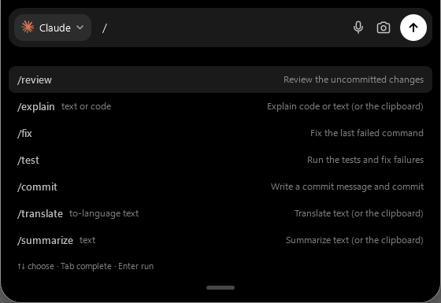

# TheAI

**A notch for Windows** that keeps your AI agents, builds, music and day at the top of the screen.

[Download for Windows](https://github.com/build-zaidana/theai-app/releases/latest) · [Website](https://build-zaidana.github.io/theai-app/) · [Report a problem](https://github.com/build-zaidana/theai-app/issues/new/choose)



Free · Windows 10 (1809+) and 11 · x64 · no account needed

## What it does

- **Agents in the notch.** Claude Code, Codex and Gemini CLI report what they're doing and ask for permission in the notch — including the sessions you run in the terminal, VS Code or the desktop apps.
- **Command palette.** Type `/` in the launcher: `/review`, `/explain`, `/fix`, `/test`, `/commit`, `/translate ja`, `/summarize`, `/focus 25`, `/timer 10`, `/recap`… and your own templates.
- **Builds, CI and scripts report themselves.** Long PowerShell commands, your pull request's checks (through your GitHub CLI) and anything a script sends with `TheAI.exe activity` show up as live activities. A failure goes to your agent in one click.
- **Focus first.** During a pomodoro or a meeting, agent results and permission requests wait and appear together at the break.
- **The rest of your day.** Timer and pomodoro, calendar countdown with a join button, music with controls, clipboard history (opt-in), a file shelf, today's recap for standup, and a system page — each optional.
- **Out of the way.** Hides while a game or video is fullscreen; about 1% of one CPU core and ~125 MB of memory at rest.

## Install

1. Download `TheAI-Setup-<version>.exe` from [Releases](https://github.com/build-zaidana/theai-app/releases/latest).
2. Run it. It installs for your user only — no administrator rights.
3. If Windows shows "Windows protected your PC", choose **More info → Run anyway**. The installer isn't code-signed yet; each release lists its SHA-256 so you can check the download:

   ```powershell
   Get-FileHash .\TheAI-Setup-1.5.0.exe -Algorithm SHA256
   ```

TheAI needs one AI to talk to: Claude Code or Codex (signed in with your subscription), or an API key for Anthropic, OpenAI or OpenRouter. It walks you through this on first start.

Updates: TheAI checks once a day and offers **Update now**; the new installer is verified against the release checksum before it runs.

Coming from **CodexBar**? Install TheAI over it — settings, conversations and saved keys move over on the first start.

## Privacy

No account, no analytics, nothing sent in the background.

| Talks to the network | Why |
|---|---|
| Your AI provider | Only what you ask, through the agent or API key you choose |
| GitHub (api.github.com), once a day | To see whether a new version is out |
| Optional, off until enabled | PR checks via your own GitHub CLI · synced lyrics (lrclib.net) · an iCal calendar link |

Everything else stays on your PC: settings, conversations and the daily recap in `%LOCALAPPDATA%\TheAI`; API keys and the calendar link in Windows Credential Manager; clipboard history in memory only.

## Reporting a problem

Use [Issues](https://github.com/build-zaidana/theai-app/issues/new/choose). If TheAI closes unexpectedly, the next start offers **Report** — it opens a pre-filled issue you can read before sending.

## Bahasa Indonesia

TheAI adalah notch untuk Windows: agent AI (Claude Code, Codex, Gemini CLI), build & CI, musik, timer, kalender, dan clipboard di puncak layar. Gratis untuk Windows 10 (1809+) dan 11. Antarmukanya mengikuti bahasa Windows (Indonesia atau Inggris). Unduh di [Releases](https://github.com/build-zaidana/theai-app/releases/latest); kalau muncul "Windows protected your PC", pilih **More info → Run anyway** (installer belum bertanda tangan kode).

---

TheAI is free to use; the source is not public. See [LICENSE](LICENSE.md). Not affiliated with Anthropic, OpenAI or Google.
